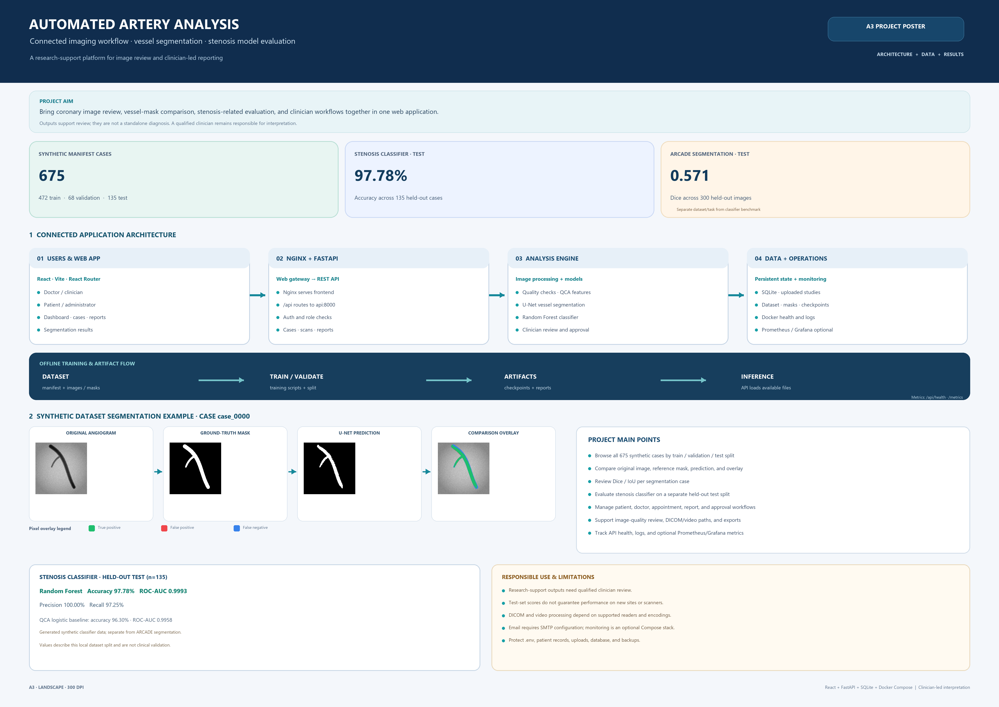

# Automated Artery Analysis
## Complete project explanation and presentation guide

This guide explains the architecture, application workflows, dataset, models, deployment, monitoring, limitations, and how to present the project. The architecture files are included with the guide.

**Project poster:** [A3 PNG](architecture/artery_project_poster_a3.png) · [Print-ready A3 PDF](architecture/artery_project_poster_a3.pdf)  
**Detailed architecture sheet:** [A3 PNG](architecture/artery_project_architecture_a3.png) · [Print-ready A3 PDF](architecture/artery_project_architecture_a3.pdf)

## 1. Project purpose

Automated Artery Analysis is a web application for cardiovascular image review and related research workflows. It brings together image quality checks, vessel segmentation, stenosis-related analysis, case and patient records, clinician review, reports, and model evaluation.

The application is decision-support software. Model outputs and measurements need qualified clinician review. They are not a standalone diagnosis or a substitute for clinical judgment.

## 2. How to read the architecture poster

Read the diagram from top to bottom:

1. Users open the React web application in a browser.
2. Nginx serves the built website and routes API requests to the backend.
3. FastAPI authenticates requests, coordinates workflows, and calls imaging/model code.
4. The API reads and writes the SQLite database, uploaded files, dataset files, and model artifacts.
5. Offline training scripts produce model files and reports; Docker Compose runs the web/API containers; optional Prometheus and Grafana provide monitoring.

Arrows indicate browser requests, API routing, data access, model artifact flow, or deployment relationships. The image panels are generated synthetic case case_0000. They show a source illustration, reference mask, U-Net output, and comparison overlay; they contain no patient study.

## 3. Technologies and responsibilities

| Layer | Technology | Responsibility |
|---|---|---|
| Frontend | React 18, Vite, React Router, Tailwind CSS | Browser interface, pages, navigation, forms, charts, and result views |
| Web server | Nginx | Serves frontend files, supports browser routes, proxies API requests |
| Backend | Python, FastAPI, Uvicorn | Authentication, REST endpoints, clinical-style workflows, analysis coordination |
| Imaging and ML | Python imaging stack, PyTorch where available, classical ML | Image preparation, segmentation, QCA features, classifier inference |
| Application data | SQLite | Users, cases, scans, appointments, reports, messages, notifications, and workflow records |
| Files | Project dataset, uploads, checkpoints, reports, Docker volumes/mounts | Imaging inputs, masks, model files, and generated artifacts |
| Deployment | Docker Compose | Builds and runs the web and API containers, health checks, network and persistence |
| Monitoring | Prometheus and Grafana, optional | Scrapes API metrics and displays monitoring dashboards |

## 4. Browser and frontend

The frontend is a single-page React application. React Router maps URLs to separate pages. Nginx serves the app shell when the user opens those routes. Browser API calls use relative /api URLs, so they pass through Nginx instead of connecting directly to the internal API container.

The application contains pages for the dashboard, cases, patients, image upload and analysis, quality checks, vessel segmentation results, model training/testing, reports and history, model registry, notifications, audit/activity logs, appointments, messaging, clinician assistance, and language preferences.

The page areas shown to a user depend on login, their role, and authorization rules. The frontend handles presentation and user interaction; the API validates and performs protected data operations.

## 5. Web server and request path

In the Docker deployment, the flow is:

1. The browser requests the website from the web service.
2. Nginx serves the compiled HTML, JavaScript, CSS, and related static files.
3. Requests beginning with /api are proxied to the API service at api:8000 on the private Compose network.
4. FastAPI validates the request and user, then performs the workflow.
5. The backend reads/writes records and files or invokes image/model code.
6. The API response returns through Nginx to the browser.

The default browser URL is http://localhost:8081. Host port 8081 maps to port 80 in the Nginx container. The backend listens on port 8000 inside the Compose network. API documentation is proxied under /docs.

## 6. FastAPI backend

The backend is the coordination layer between the frontend, persistent data, image processing, and model artifacts. It provides:

- Login, registration, identity lookup, and role-aware authorization.
- Patient, doctor, case, scan, appointment, message, notification, and report workflows.
- Upload validation and image-quality checks.
- Vessel segmentation and stenosis-related analysis endpoints.
- Evaluation reports and model artifact access.
- CSV/JSON export and report/print workflows.
- Optional email notification scheduling when SMTP is configured.
- Health status at /api/health, Prometheus metrics at /metrics, and request logging.

Uvicorn runs the FastAPI app. Docker starts it on 0.0.0.0:8000; Nginx reaches it by the Compose service name.

## 7. Imaging and analysis workflow

A typical analysis flow is:

1. An authenticated user selects an existing case or uploads an image/study.
2. The backend validates the file and converts it into an image representation suitable for available processing.
3. Image-quality checks identify potential input issues.
4. The segmentation engine generates a vessel-mask prediction when a compatible model/checkpoint is available.
5. The QCA feature pipeline and stenosis classifier produce candidate measurements/predictions when the required input and artifacts are available.
6. The API stores report state and result metadata and returns visualizations to the frontend.
7. A clinician reviews the original image, model output, measurements, limitations, and report before approval or use.

The backend includes image, DICOM, and video handling paths. Exact DICOM/video decoding and analysis depend on installed readers, dependencies, and the encoding of the input. Video analysis uses frames; it does not mean every codec or study format will work automatically.

## 8. Vessel segmentation results page

The dedicated Vessel Segmentation Results page reads the manifest and allows browsing all, train, validation, or held-out test examples. The current local generated synthetic manifest has 675 cases: 472 train, 68 validation, and 135 test. All 675 had corresponding image and mask files when checked. The full image collection is git-ignored because it is multi-gigabyte; recreate it locally with dataset/build_large_dataset.py. Deployment results depend on generating/providing that data before building the API image.

Each paginated result displays:

- Original angiogram: the source image.
- Ground-truth mask: the reference annotation.
- U-Net prediction: the output produced by the configured inference engine.
- Overlay: comparison of the prediction and reference. Green is true-positive vessel pixels, red is false-positive pixels, and blue is false-negative pixels.
- Dice and IoU: pixel-overlap scores calculated against that case's reference mask.
- Split label: train, validation, or test.

The page requests six cases at a time by default to keep responses manageable. It can browse the full eligible manifest with previous/next navigation. Cases without a readable image or reference mask are excluded.

Training examples fit model parameters. Validation examples support selection/tuning. Test examples are held out for final performance evaluation. The gallery can display examples from each split, but headline model performance must be calculated on the held-out test set.

## 9. Dataset and data files

The main vessel-analysis data is organized as:

- dataset/clinical_manifest.csv: metadata, labels, split information, and filenames.
- dataset/images/: source angiograms/image representations.
- dataset/masks/: reference vessel annotations.
- dataset/: optional research assets such as ARCade/CADICA data and related files.

The manifest links each case to its image and reference mask. The results endpoint checks for the files before including a case. When building the API Docker image, the Dockerfile copies dataset files into that image. To use changed dataset files in Docker, rebuild the API image unless the Compose file is configured to mount the dataset from the host.

The SQLite database contains application records. Uploaded images and generated artifacts are files; the database stores metadata and references. Compose volumes and host mounts persist selected files outside the container.

## 10. Training and evaluation

Training is performed by scripts under training/. Normal app startup does not retrain models. The app consumes the model artifacts and reports that are available to it.

The repository contains several model workflows:

- U-Net/U-Net++ segmentation training and inference, using a compatible checkpoint when available.
- A classical Random Forest stenosis classifier using extracted QCA-related features.
- A logistic-regression QCA-feature baseline for comparison in the held-out evaluation report.
- Optional ARCade/CADICA research workflows where data and compatible artifacts exist.

The configured stenosis benchmark report used the generated 675-case synthetic dataset: 472 train, 68 validation, and 135 held-out test. The local held-out report recorded:

| Classifier | Accuracy | ROC AUC | Precision | Recall |
|---|---:|---:|---:|---:|
| Random Forest stenosis model | 97.78% | 0.9993 | 100.00% | 97.25% |
| Logistic-regression QCA baseline | 96.30% | 0.9958 | 100.00% | 95.41% |

These figures describe that local report and split. They do not prove clinical effectiveness or guarantee results on other institutions, scanners, populations, or image types. This configured stenosis classifier is Random Forest; it should not be described as a trained PyTorch StenosisResNet. Segmentation Dice/IoU and classifier accuracy/ROC AUC/precision/recall measure different tasks and should not be interchanged.

## 11. Persistence, notifications, and review

SQLite stores application entities such as users, cases, scans, analysis results, appointments, reports, messages, notifications, and workflow/audit records. Uploaded studies and model artifacts are separate files. Backups should include the database, uploaded files, and any reports/checkpoints needed for recovery.

In-app notifications are stored and shown in the portal. Email is optional and depends on valid SMTP host, port, credentials, sender, and TLS settings in .env. Without configured SMTP, do not claim that an email was sent.

Doctor review/approval workflows assign a clinician responsibility for final interpretation. Model outputs are decision-support material, not autonomous clinical decisions.

Avoid docker compose down -v if you need to retain Compose-managed volumes: the -v option removes them.

## 12. Deployment, health, logging, monitoring

The main Compose deployment builds two services:

- web: Nginx serving the compiled frontend and forwarding API calls.
- api: FastAPI/Uvicorn handling application endpoints and model processing.

Compose connects them on a bridge network, checks API health before starting the web service, applies restart policies, rotates container logs, and configures persistent mounts.

The backend exposes /api/health for service/model status and /metrics for Prometheus-compatible request counters and timings. Docker health checks use the API health endpoint. Logging is configured in the backend and container runtime.

Optional monitoring consists of Prometheus and Grafana. Prometheus scrapes the API /metrics endpoint; Grafana presents configured dashboards. Run monitoring together with the main app by combining the Compose files:

    docker compose -f docker-compose.yml -f docker-compose.monitoring.yml up --build -d

Default local addresses are Grafana http://localhost:3001 and Prometheus http://localhost:9090. Monitoring credentials are read from .env.

## 13. Security and environment configuration

The deployment reads its signing secret and optional service credentials from .env. It binds the web service to localhost by default, runs the API as a non-root user, uses a mostly read-only API filesystem with a temporary writable area, drops Linux capabilities, and enables no-new-privileges.

Keep .env private. It can contain the app secret, SMTP credentials, and Grafana administrator password. Do not paste it into a report or public message. Preserve the existing secret between restarts; changing it may invalidate signed sessions/tokens.

These local deployment controls are not a full production security or compliance review. Real deployment requires institution-specific identity, privacy, networking, storage, backup, regulatory, and clinical validation work.

## 14. Run the application

Start Docker Desktop and wait for the Linux engine. Then use PowerShell:

    Set-Location C:\html\Artery_Medical_Final_Complete\Artery_Medical
    if (-not (Test-Path .env)) { Copy-Item .env.docker.example .env }

If .env was newly created from the example, replace the placeholder secret once:

    $envPath = Join-Path (Get-Location) '.env'
    $envText = [System.IO.File]::ReadAllText($envPath)
    if ($envText.Contains('replace-with-a-long-random-secret-before-deploying')) {
        $bytes = New-Object byte[] 48
        $rng = [System.Security.Cryptography.RandomNumberGenerator]::Create()
        $rng.GetBytes($bytes)
        $secret = [Convert]::ToBase64String($bytes)
        $rng.Dispose()
        $envText = $envText.Replace('replace-with-a-long-random-secret-before-deploying', $secret)
        [System.IO.File]::WriteAllText($envPath, $envText, (New-Object System.Text.UTF8Encoding($false)))
    }

Then verify and launch:

    docker info
    docker compose config --quiet
    docker compose up --build -d
    docker compose ps

Open http://localhost:8081. The segmentation page is http://localhost:8081/segmentation-results. API health is http://localhost:8081/api/health.

To stop the containers while retaining volumes:

    docker compose down

## 15. Refresh training artifacts

Training may take time and is separate from application startup. Follow training/README.txt and training/requirements_segmentation.txt for the segmentation workflow and dependencies. A typical classical training/evaluation invocation from the project root is:

    Set-Location C:\html\Artery_Medical_Final_Complete\Artery_Medical
    .\.venv\Scripts\Activate.ps1
    python training\train.py
    python training\test.py

After changing files copied into the API image, rebuild with docker compose up --build -d.

## 16. Presentation script

### Opening summary

“Automated Artery Analysis is a web application that brings cardiovascular image review, vessel segmentation, stenosis-related model evaluation, patient/doctor workflows, and reporting into one system. It uses a React frontend, a FastAPI backend, local dataset and model artifacts, and Docker Compose for deployment. Outputs support review; a qualified clinician remains responsible for interpretation.”

### Walk through the diagram

“Users interact with the React website. Nginx serves the site and forwards API calls to FastAPI. The API checks access, manages clinical-style records, and calls imaging/model code. It reads and writes SQLite and file storage. Offline training scripts use the dataset to create model artifacts and reports. Docker Compose runs web and API services. Prometheus and Grafana are optional monitoring services.”

### Explain the segmentation sequence

“The image sequence uses a generated synthetic angiogram, its reference mask, the U-Net prediction, and a color-coded comparison. True-positive pixels are green, false positives red, and false negatives blue. Dice and IoU summarize overlap with the reference.”

### Explain evaluation

“The classifier's final report is based on the held-out test split. The reported values describe this dataset and configuration only; they do not establish external clinical validation. Segmentation overlap scores and stenosis classification scores evaluate different tasks.”

### Explain deployment

“Compose builds the Nginx frontend and FastAPI backend, connects them on a private bridge network, checks API health, and mounts persistent files. Users open the web service on port 8081. Monitoring is enabled by including the second Compose file.”

## 17. Common questions

**What problem does the project address?**  
It organizes artery image review, segmentation comparison, stenosis-related evaluation, clinical-style case workflows, and report review.

**What does the AI do?**  
The configured workflow includes vessel segmentation inference with a compatible U-Net-family checkpoint and a classical QCA-feature stenosis classifier. A logistic-regression baseline supports comparison.

**How is data leakage reduced?**  
Training, validation, and held-out test examples are kept in separate splits. The held-out test split is used for final benchmark reporting.

**Can it diagnose a patient?**  
No. It produces research/support outputs requiring qualified clinician review. Clinical use requires independent validation and appropriate institutional approval.

**What if SMTP is not configured?**  
In-app notifications can still work. External email requires configured SMTP and successful delivery.

**How do I check service status?**  
Use docker compose ps, docker compose logs -f api, or open http://localhost:8081/api/health.

**How are files preserved?**  
Compose volumes and host mounts persist configured state. Backups need the database, uploads, and required artifacts. Avoid docker compose down -v when preserving volumes.

## 18. Limitations and future work

- Model quality depends on the training data, annotations, image quality, and compatible checkpoints.
- A single held-out dataset result is not external clinical validation.
- DICOM/video support depends on imaging libraries and file encoding; some sites need additional integration.
- SQLite/local file storage is suitable for this contained project but may need managed databases, object storage, access controls, and backup automation at larger scale.
- Email alerts rely on SMTP configuration and availability.
- Privacy, audit retention, model/version tracking, clinical approval, and regulatory requirements need review before real-world deployment.
- The software should not be presented as providing autonomous diagnosis or treatment recommendations.

## 19. Important project files

| Path | Purpose |
|---|---|
| artery-ai-frontend/src/pages/ | Browser pages, including Dashboard, Training, and VesselSegmentationResults |
| artery-ai-frontend/src/services/api.js | Frontend API request functions |
| backend/main.py | FastAPI endpoints and application workflows |
| backend/ai_engine.py | Model loading and inference integration |
| dataset/clinical_manifest.csv | Dataset index, labels, and split information |
| dataset/images/ and dataset/masks/ | Source images and segmentation references |
| training/ | Split, training, feature extraction, and evaluation scripts |
| docker-compose.yml | Main deployment, health checks, networks, and persistent mounts |
| docker-compose.monitoring.yml | Optional Prometheus and Grafana services |
| deploy/monitoring/prometheus.yml | Prometheus scrape configuration |
| docs/architecture/ | A3 poster exports |

## 20. Print and download

The A3 PDF is landscape at 300 DPI. Print using A3 paper, Landscape, and Actual size/100%. The PNG is useful for viewing and inserting into slides. This Markdown guide can be opened in VS Code or another Markdown reader.

To copy the poster image and PDF to the current Windows user's Downloads folder, run in PowerShell:

    $source = 'C:\html\Artery_Medical_Final_Complete\Artery_Medical\docs\architecture'
    $png = Join-Path $env:USERPROFILE 'Downloads\Artery_Project_Architecture_A3.png'
    $pdf = Join-Path $env:USERPROFILE 'Downloads\Artery_Project_Architecture_A3.pdf'
    Copy-Item (Join-Path $source 'artery_project_architecture_a3.png') $png -Force
    Copy-Item (Join-Path $source 'artery_project_architecture_a3.pdf') $pdf -Force
    Start-Process $png

If the files are missing, regenerate them from the project root:

    Set-Location C:\html\Artery_Medical_Final_Complete\Artery_Medical
    .\.venv\Scripts\python.exe scripts\generate_architecture_sheet.py
